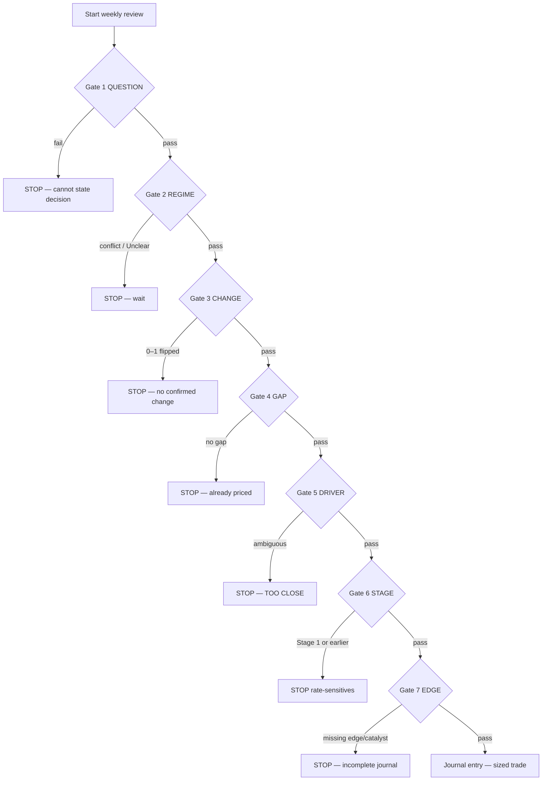

# India Regime Engine — Operating Flowchart (Seven Gates)

| Field | Value |
|-------|-------|
| **Document** | Rejection-machine operating flowchart |
| **Live app** | https://cakashoza-cmyk.github.io/india-regime-engine/ |
| **Source repo** | https://github.com/cakashoza-cmyk/india-regime-engine |
| **Companion** | [AUDIT_LOGIC.md](./AUDIT_LOGIC.md) (code rules as implemented) |
| **As of** | 2026-10-26 Asia/Calcutta |
| **Owner** | Akash Oza |

This is a **rejection machine**. Most weeks you stop early. NO TRADE / STOP / Unclear is a valid and preferred output. The process never claims to replace judgment.

---

## Mental model (one sentence)

Run the seven gates. Stop at the first one that says no. Most weeks, you stop early. When you get all the way to Gate 7, you have a trade — with a named edge, a catalyst, an invalidation, and a size. Write it down.

---

## Master flowchart

**Rule:** unlock the next gate only on PROCEED. First STOP ends the week for that idea.

---

## Gate specifications

### Gate 1 — QUESTION
**Ask:** One sentence — what asset / horizon / decision are you evaluating?
**Stop rule:** Cannot state it clearly → **STOP**.
**Output:** The sentence, written.

### Gate 2 — REGIME
**Ask:** Where are the three dials (Growth, Inflation, Liquidity) plus the market’s vote?
**Logic (live app):** Reuse scoring — `majorityDirection` ≥ 60%, Growth = GDP+IIP only, Inflation Transitory ≠ Rising, liquidity stress hard override, sleeve map. Conflict between dials or Unclear sleeve → **STOP Unclear**.
**Output:** Dial scores, sleeve label, confirmation status. AI fills tagged **ai**, not fact.

### Gate 3 — CHANGE
**Ask:** Leading-indicator watchlist — which signals have flipped?
**Stop rule:** 0–1 indicators flipped → **STOP** (no confirmed change). Need a confirmation cluster.
**Output:** Checklist of flips (user + AI suggestions). AI suggestions labeled AI-assisted.

### Gate 4 — GAP
**Ask:** What is priced in vs what does the evidence say?
**Stop rule:** No gap → **STOP** (already in the price).
**Output:** Priced-in statement; evidence statement; named gap.

### Gate 5 — DRIVER
**Ask:** Pick candidate sectors; decompose 2–4 drivers; change × transmission → marginal driver + direction.
**Stop rule:** Ambiguous / ties → **TOO CLOSE / STOP**.
**Output:** Sector picks, driver table, marginal driver and direction.

### Gate 6 — STAGE
**Ask:** Where are we in the sequence (Stages 1–6)?
**Stop rule:** Stage 1 or earlier → **STOP rate-sensitives** (too early for that sleeve).
**Output:** Stage diagnosis + posture.

### Gate 7 — EDGE
**Ask:** Journal form — date, call, reason, edge, catalyst, invalidation, sizing, check-back.
**Stop rule:** Missing named edge or catalyst → **STOP**.
**Output:** Printable journal entry (optional JSON/MD download). AI may draft; user edits; always labeled AI draft until accepted.

---

## Reference tables

### Regime → what leads / lags / posture

| Regime | What leads | What lags | Posture |
|--------|------------|-----------|---------|
| Goldilocks | Midcaps, smallcaps, consumer discretionary, real estate, banks | Defensives, gold, cash | Aggressive — fully invested, favor beta |
| Reflation | Banks, PSUs, industrials, commodities, energy | IT, staples, long-duration bonds | Cyclical — own the recovery |
| Tightening | IT (weak rupee), exporters, quality largecaps, PSU banks | Real estate, NBFCs, leveraged midcaps, autos | Defensive — quality, cash, wait |
| Slowdown | Long-duration bonds first, then rate-sensitives | Commodities, banks, cyclicals | Patient — bonds then equities |
| Stagflation | Cash, gold, staples, utilities | Everything leveraged | Preserve capital — cash is a position |

### Sequence stages (Slowdown → recovery → next cycle)

| Stage | What happens | Evidence | Action |
|-------|--------------|----------|--------|
| 1 | Bonds rally | Growth slows; inflation falls; yields fall | Own duration / bonds; **do not** buy rate-sensitives yet |
| 2 | Rate-cut signal | RBI cuts or clearly signals | Prepare watchlist; still cautious on equities |
| 3 | Rate-sensitives bottom | Ratio rises; breadth improves | Add rate-sensitives (size) |
| 4 | Cyclicals recover | Capex, PMI new orders, order books rise | Rotate to cyclicals |
| 5 | Commodities rally | Commodity prices, inflation expectations rise | Rotate to commodities |
| 6 | Next tightening | Inflation rises; central bank hardens | Rotate to defensives |

---

## How to Practice

| Weeks | Scope |
|-------|--------|
| 1–2 | Gates 1–3 only |
| 3–4 | Add Gate 4 |
| 5–6 | Add Gate 5 |
| 7–8 | Gates 6–7 paper only |

**One-page rule:** One gate at a time until the gate runs itself.

Practice mode in the live app mirrors this ramp (Gates 1–3 / through 4 / through 5 / full).

---

## Implemented vs Target

| Gate | Target | Status in UI |
|------|--------|--------------|
| 1 QUESTION | Capture one-sentence decision; STOP if blank | **In UI** (wizard) |
| 2 REGIME | 3 dials + market vote; Unclear → STOP | **In UI** (reuses prior scoring engine) |
| 3 CHANGE | Leading-indicator flip checklist | **In UI**; AI suggests flips (AI-assisted) |
| 4 GAP | Priced-in vs evidence | **In UI** |
| 5 DRIVER | Sector drivers → marginal driver | **In UI**; AI can draft table |
| 6 STAGE | Stages 1–6 checklist | **In UI**; AI stage diagnosis |
| 7 EDGE | Journal + export | **In UI**; AI draft journal |

**Snapshot feeds (2026-10-26):** FII/DII equity cash CM + India 10Y auto-populated by `refresh_data.py` into Gate 2 Liquidity (null if scrape fails). Soft proxy default OFF.

**Automation stance:** DeepSeek assists fill/interpret. Outputs are **AI-assisted, not authoritative**. User must verify MOSPI / RBI / NSDL / filings. Yahoo `data/snapshot.json` remains the market feed. Legacy single-page sleeve view kept as secondary tab **Legacy sleeve**.

---

## Links

- Live: https://cakashoza-cmyk.github.io/india-regime-engine/
- Repo: https://github.com/cakashoza-cmyk/india-regime-engine
- Logic audit: [AUDIT_LOGIC.md](./AUDIT_LOGIC.md)
